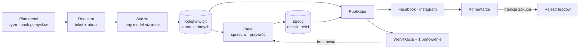
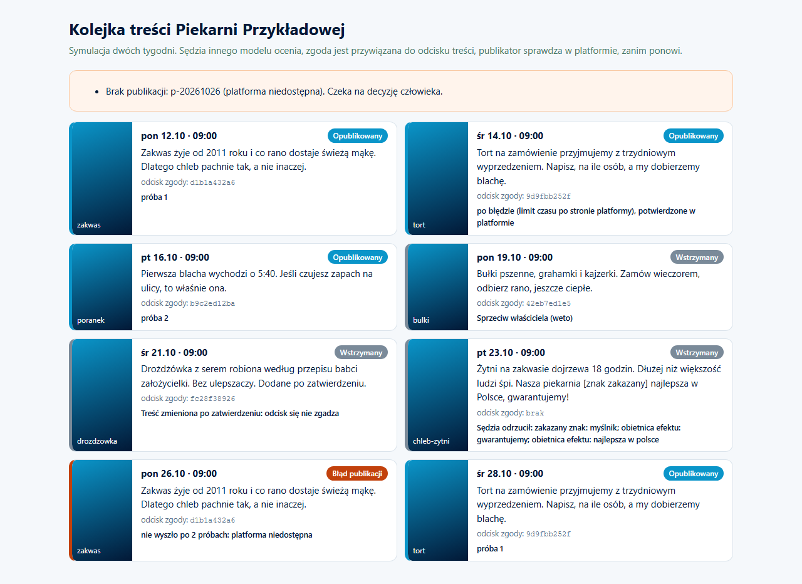

# Content Engine


Autonomiczny marketing firmy: redaktor planuje i tworzy posty, sędzia ocenia, publikator wypuszcza tylko to, na co jest ważna zgoda, a strażnik sprawdza, czy publikacja naprawdę się pojawiła.

*Autonomous marketing: an editor plans and produces posts, a judge reviews them, a publisher releases only what has a valid approval, and a watchdog checks the post actually went live.*

> Wizytówka projektu. Kod produkcyjny jest prywatny. / Showcase repository. Production code is private.

---

## PL

### Problem
Marketing małej firmy umiera na dwóch końcach: brakuje czasu na produkcję, a gdy produkcja jest zautomatyzowana, człowiek traci kontrolę nad tym, co wychodzi pod marką. Do tego publikacja potrafi cicho się nie udać.

### Rozwiązanie
Łańcuch z jasnym kontraktem danych między ogniwami:
1. **Plan treści** z rytmem tygodnia i bankiem pomysłów; brakujące sloty wykrywane z wyprzedzeniem.
2. **Redaktor** (dwa razy dziennie na serwerze) utrzymuje obsadzone najbliższe dni: teksty z modelu językowego, grafiki z generatora obrazów z referencjami stylu marki.
3. **Sędzia** ocenia tekst i obraz innym modelem niż autor.
4. **Panel**: kolejka na najbliższe dni, sprzeciw jednym kliknięciem (zamiennik powstaje automatycznie), przywrócenie.
5. **Publikator** (co 10 minut w godzinach dnia) publikuje na Facebooku i Instagramie, a pakiety LinkedIn przygotowuje do ręcznego udostępnienia.
6. **Weryfikacja i czujka**: po błędzie sprawdza w platformie, czy post jednak wyszedł, ponawia raz, a brak publikacji zakłada decyzję w panelu.
7. **Komentarze** z intencją zakupową trafiają jako lead do rejestru.

### Architektura



### Decyzje projektowe
- **Zgoda przywiązana do treści.** Zatwierdzenie to odcisk `sha256(obraz + "\n" + tekst)`. Każda zmiana obrazu albo tekstu po zatwierdzeniu unieważnia zgodę; publikator wymaga naraz treści z repozytorium i pasującego odcisku.
- **Weto zamiast bramki per sztuka.** Przy dużej liczbie treści człowiek nie klika każdej; treść zaplanowana wychodzi sama, chyba że ktoś zgłosi sprzeciw.
- **Kontrakt kolejki wersjonowany** (`KONTRAKT.md`): nazwy pól zamrożone, bo zmiana nazwy pola obrazu unieważniłaby wszystkie zgody.
- **Limity kosztu na poziomie klucza**: osobny klucz redaktora z miesięcznym limitem i dzienny limit liczby obrazów.
- **Publikacja nie ufa odpowiedzi API.** Błąd może znaczyć, że post jednak wyszedł; stąd weryfikacja przed ponowieniem, żeby nie było dubli.

### Wybrany fragment kodu

```python
import hashlib

def odcisk(obraz: str, tresc: str) -> str:
    """Zgoda dotyczy dokładnie tej pary obraz + tekst. Zmiana czegokolwiek = brak zgody."""
    return hashlib.sha256(f"{obraz}\n{tresc.strip()}".encode("utf-8")).hexdigest()

def mozna_publikowac(wpis: dict, zgody: dict) -> bool:
    zgoda = zgody.get(wpis["id"])
    return bool(zgoda) and zgoda.get("werdykt") != "odrzucony" \
        and zgoda.get("odcisk") == odcisk(wpis["obraz"], wpis["tresc"])
```

### Stack
Python, cron na VPS, OpenRouter (tekst i sędzia), API generowania obrazów z referencjami, Meta Graph API, n8n, PostgreSQL (materiały, komentarze, pomiar ruchu bez ciasteczek), React (widok marketingu w panelu).

### Efekt
Łańcuch działa produkcyjnie: plan, produkcja, ocena, publikacja i kontrola publikacji bez ręcznego składania postów. Człowiek zostaje przy weto i kierunku.

---

## EN

**Problem.** Small business marketing dies at both ends: no time to produce, and once production is automated the owner loses control over what goes out under the brand. Publishing can also fail silently.

**Solution.** A chain with an explicit data contract: content plan with weekly rhythm and idea bank; an editor running twice a day that keeps the next days filled (LLM copy, images with brand style references); a judge using a different model than the author; a dashboard queue with one-click veto and automatic replacement; a publisher every 10 minutes (Facebook, Instagram, LinkedIn packages for manual sharing); verification and one retry after errors; purchase-intent comments routed to the lead registry.

**Design decisions.** Approvals are bound to content by a SHA-256 fingerprint of image plus text. Veto instead of per-item gate at volume. Frozen, versioned queue contract. Cost limits at key level. The publisher does not trust API errors: it verifies before retrying to avoid duplicates.

**Result.** In production: planning, production, review, publishing and publish verification without hand-assembled posts. The human keeps veto and direction.

## Jak uruchomić / Run it

Przykład w repozytorium to działający szkielet na firmie fikcyjnej (Piekarnia Przykładowa): redaktor z bankiem pomysłów, sędzia regułowy, zgoda z odciskiem, weto, publikator z weryfikacją i symulowana platforma. Bez kluczy i bez sieci. W produkcji tekst pisze model językowy, a publikuje Meta Graph API.
*A working skeleton on a fictional company: editor with an idea bank, rule-based judge, fingerprinted approval, veto, verifying publisher, simulated platform. No keys, no network.*

```bash
pip install -r requirements.txt
python -m pytest -q            # 14 testów
python demo/make_demo.py       # symulacja, zapisuje demo/queue.html i zrzut (playwright install chromium)
```

Struktura: `engine/approval.py` (odcisk, weto), `engine/judge.py` (sędzia), `engine/editor.py` (redaktor), `engine/publisher.py` (publikator), `engine/simulation.py` (scenariusz), `KONTRAKT.md`.

### Demo: kolejka na dwa tygodnie

Osiem wpisów, wszystkie trudne przypadki naraz: publikacja po fałszywym błędzie bez dubla, ponowienie po chwilowym błędzie, weto właściciela, treść zmieniona po zatwierdzeniu, odrzucenie przez sędziego, trwała awaria zamieniona w decyzję.
*Eight posts covering the hard cases: no duplicate after a false error, retry after a transient one, owner veto, edit after approval, judge rejection, permanent failure turned into a decision.*



---

<p align="center"><br>
Zbudowane w <a href="https://cyfrownia.com">Cyfrowni</a>, agencji AI z Grudziądza. Kontakt: <a href="mailto:biuro@cyfrownia.com">biuro@cyfrownia.com</a></p>
